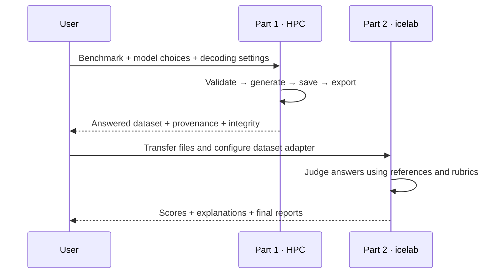

# Part 1 → Part 2 handoff

The project has two repositories because the icelab judge is inaccessible from HPC. Part 1 generates model answers on Slurm. Part 2, already pushed to GitHub, owns judge setup, rubrics, scoring, aggregation and final evaluation reports. Its repository URL/CLI are not present in this checkout; consult its README for exact judge commands.

## Package an answered dataset

Run `python scripts/prepare_judge_dataset.py --help` for every option. It accepts JSONL or XLSX (first sheet by default), validates unique nonempty `question_id`, nonempty `question`, `reference_answer`, and the selected answer column. It requires exactly the expected row count when supplied. It preserves original columns and refuses to overwrite an existing output. It does not filter capped answers or assert that answers are correct.

Part 2 should map the following fields according to its own adapter:

| Part 1 field | Meaning in Part 2 |
|---|---|
| `question_id` | Stable join key; preserve across all scores |
| `question` | Original prompt/input |
| `<model>_answer` | Actual model output to judge |
| `reference_answer` | Expected/reference output |
| `context_text` | Supporting context, if the selected metric needs it |
| `language` | English/French grouping |
| `primary_metric`, `applicable_metrics` | Rubric selection, using Part 2's definitions |
| `truncated`, `response_complete`, `accepted_truncation` | Generation quality flags; do not silently discard |
| `run_id`, model revision, decoding | Experiment provenance where supplied |

Some combined workbooks contain only original columns and model answers. Pair them with `_raw.jsonl` for per-answer flags, decoding and provenance. Join on **model identity + question_id** and verify question text and workbook SHA-256. Never join by row position alone. For the sampling GC replacement, retain `replacement_provenance` and the mixed-temperature integrity report.

## Transfer checklist

1. Select one experiment; avoid mixing settings unless explicitly documented.
2. Run the preparation command from the main README for each answer column you need.
3. Copy the handoff JSONL and `.manifest.json`, original workbook, selected raw export, experiment configs and relevant integrity reports to your icelab-accessible machine using your approved file-transfer method. Check SHA-256 after transfer (`sha256sum <file>`).
4. In Part 2, install its dependencies, configure its icelab connection and map these columns using its documented commands.
5. Record the judge model/version, rubric, thresholds, dataset checksum and policy for capped answers alongside the scores.
6. Check coverage by model, language and metric before interpreting aggregated scores. Save scored records and summary reports in Part 2.

No judge credentials, endpoint, scoring implementation or judged results were found in Part 1. A generation `success` or `complete` export indicates saved-answer coverage under that experiment's policy; it is not a judge score.
